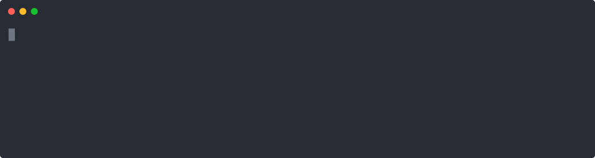
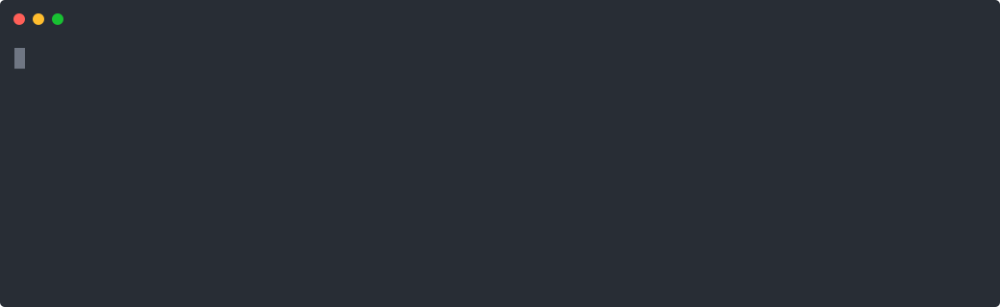
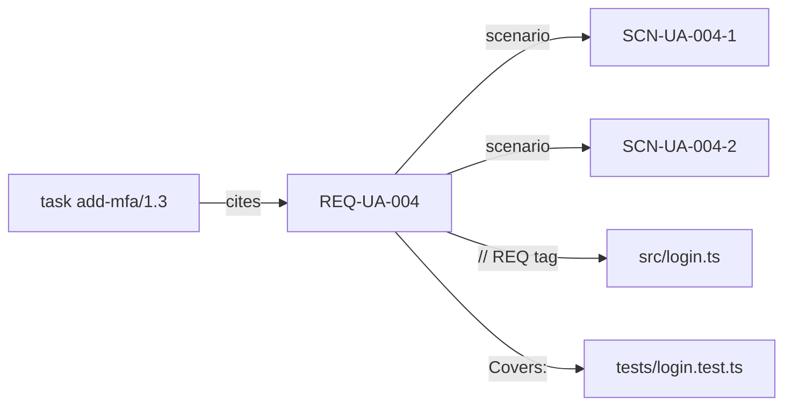

# spec-ctx

Stable IDs for OpenSpec. Your coding agent loads only the spec one task needs, and knows what to do next.

For teams that run Claude Code, Codex, or Cursor on an OpenSpec project.

## What OpenSpec is

[OpenSpec](https://github.com/Fission-AI/OpenSpec) is a folder named `openspec/` in your repo. It holds specs, the rules your software must follow, and changes. A change holds a proposal, a design, and a task list. A coding agent reads them and works down the list.

## The problem

Three things go wrong.

- The agent reads the whole `openspec/` tree for every task. Most of it is not about the task. Tokens go to text the agent will not use.
- OpenSpec links a change to a spec by header text. A reword breaks the link, and the agent loses the thread between requirement, code, and test.
- A new session starts cold. The agent does not know which task is next, what it already did, or which questions are open.

## What spec-ctx adds

| Without | With spec-ctx |
| --- | --- |
| The agent reads the whole `openspec/` tree. | The agent gets the bundle of one task: the requirements it cites, their scenarios, decisions, and neighbors. |
| Links go by header text. | Every requirement, scenario, decision, and task has an ID. Code and tests carry tags that name it. |
| Each session starts cold. | `status`, `task next`, and the generated handoff say where the work stands. |
| The agent ticks `[x]` by hand. | `[x]` appears only after the Verify command of the task exits 0. The run leaves an evidence file. |

A later edit can break a task that passed. `check --strict` names each task whose files changed after its Verify passed. While a change has an open task or no task, it prints a `deferred:` line for the delta items it did not test yet.

No LLM call. No daemon. The same files give the same output.

## Try it in two minutes

Paste this block in a shell. It builds a toy project, then runs the loop on one task. It needs Node 22, `git`, and `npx`.

<!-- try:begin -->
```bash
set -e
mkdir -p spec-ctx-try && cd spec-ctx-try && git init -q
mkdir -p openspec/specs/user-auth openspec/changes/add-mfa/specs/user-auth src tests
cat > openspec/specs/user-auth/spec.md <<'MD'
# user-auth

## Requirements

### Requirement: Login with a password
The system SHALL let a user log in with a username and a password.

#### Scenario: Correct password
- **WHEN** a user enters a correct password
- **THEN** the user is logged in
MD
cat > openspec/changes/add-mfa/proposal.md <<'MD'
## Why
Passwords alone are weak.

## What Changes
- Ask for a TOTP code after the password.
MD
cat > openspec/changes/add-mfa/specs/user-auth/spec.md <<'MD'
## ADDED Requirements

### Requirement: TOTP second factor
The system SHALL ask for a TOTP code after a correct password.

#### Scenario: Correct code
- **WHEN** a user enters a correct TOTP code
- **THEN** the user is logged in
MD
cat > openspec/changes/add-mfa/tasks.md <<'MD'
## 1. Login

- [ ] 1.1 Add the TOTP prompt to the login form
MD
printf '## Context\nThe login form has one step.\n' > openspec/changes/add-mfa/design.md
printf 'export const prompt = "password";\n' > src/login.ts
npx -y spec-ctx init --all
npx -y spec-ctx adopt
sed -i.bak 's/^- \[ \] 1.1 Add the TOTP prompt to the login form$/- [ ] 1.1 Add the TOTP prompt to the login form [REQ-UA-002] Verify: `grep -q totp src\/login.ts`/' openspec/changes/add-mfa/tasks.md && rm openspec/changes/add-mfa/tasks.md.bak
printf '// Covers: REQ-UA-002\n' > tests/login.test.ts
npx -y spec-ctx status
npx -y spec-ctx task next
npx -y spec-ctx task start add-mfa/1.1
npx -y spec-ctx task done add-mfa/1.1 || echo "refused, as expected"
printf '// REQ-UA-002\nexport const prompt = "password, then totp";\n' > src/login.ts
npx -y spec-ctx task done add-mfa/1.1
npx -y spec-ctx context add-mfa/1.1
npx -y spec-ctx context src/login.ts
npx -y spec-ctx handoff write
```
<!-- try:end -->

On this toy project the bundle footer shows more than 100 percent of the spec text, because the tree is tiny. On a real repo the share is small. Step 4 of the next section shows 3.6 percent.

`status` prints a `next:` line that asks for plan approval with `handoff ask --plan`. The `specctx-run` skill handles that step. This demo skips it.

## See it work

Six commands on a small project. Each clip is one command.

### 1. Give every requirement an ID

OpenSpec names a requirement by its header text. A reword breaks every link to it. `adopt` gives each requirement and scenario an ID that stays.


You see: the dry run prints each header and the ID it gets. Then `adopt` writes them.

### 2. Where are we

`status` shows the open change, the task counts, and the next command to run.


You see: one change, two tasks done, one open, and the hint.

### 3. What is next

`task next` picks the first open task. It prints the requirements the task cites and its Verify command, the shell command that proves the task is done.


You see: task `add-mfa/1.3`, its requirement, and `grep -q totp src/login.ts`.

### 4. Only the spec this task needs

`task start` prints the context of the task. It holds the task line, the requirements it cites with their scenarios, the code and test lines that tag them, and the decisions. The blocks fit a character budget. The last line compares that size with all spec text.


You see: 711 characters, 3.6 percent of the tree. The agent reads this instead of the tree.

### 5. Done means Verify passed

`task done` runs the Verify command. On exit 1 the box stays open. On exit 0 the box flips to `[x]` and an evidence file records the files that were checked.



You see: a red refusal, the edit, then a green done line.

### 6. Hand off to the next session

`handoff write` puts the state in one file: the change, the done tasks, the current task, and the open questions. The next session starts from it.



You see: the head of `.ctx/handoff.md`.

The transcript of all six clips is in `docs/demo/loop.txt`. `bash docs/demo/record.sh` records them again.

## Quickstart

spec-ctx needs Node 22. Run it in a project after `openspec init`.

```bash
npx -y spec-ctx init --all              # config, ID templates, rules, and the agent skill
npx -y spec-ctx adopt                   # only when your specs have no IDs yet
npx -y spec-ctx task next               # the next task and the command that proves it
npx -y spec-ctx task start <task>       # only the spec that this task needs
npx -y spec-ctx task done <task>        # runs that command. A pass ticks the box.
```

- `adopt --dry-run` shows the ID that each header gets and writes nothing.
- `adopt --dry-run` exits 1 when headers need IDs. A script with `set -e` must allow that code.
- [`docs/getting-started.md`](https://github.com/sonqh/spec-ctx/blob/main/docs/getting-started.md) walks the fresh path with real output.
- [`docs/reference.md`](https://github.com/sonqh/spec-ctx/blob/main/docs/reference.md) holds the install options, the path for an existing project, every command, and the config file.

## How it finds the context



The ID is the stable key. A reword of a header does not change it. The index is the graph of IDs: tasks, requirements, scenarios, decisions, code tags, and test tags. A decision record joins the graph through its `Refs:` line.

`specctx context <task|ID|path|change>` is the one command to run before you edit. It walks the edges inside a character budget and prints one provenance line for each block. When a block does not fit, a `truncated:` line names it. `related` prints each neighbor and the reason for the link:

```text
$ specctx related REQ-UA-004
scn  SCN-UA-004-1  active  openspec/changes/add-mfa/specs/user-auth/spec.md:8  scenario of REQ-UA-004
scn  SCN-UA-004-2  active  openspec/changes/add-mfa/specs/user-auth/spec.md:12  scenario of REQ-UA-004
task  add-mfa/1.3  done  openspec/changes/add-mfa/tasks.md:7  task cites REQ-UA-004
code  src/login.ts:1  active  src/login.ts:1  implements REQ-UA-004
test  tests/login.test.ts:1  active  tests/login.test.ts:1  covers REQ-UA-004
```

The reference has the budget rules and the lookups by file, by change, and by task.

## The life cycle for agents

`init --all` installs one skill, `specctx-run`. The user types one prompt, such as "build this" or "continue". The skill loops until the change reaches the archive or a human must decide.

1. It runs `specctx next --json`. The engine reads the files on disk and prints one action, such as `start`, `fix`, or `archive`.
2. It runs the exact commands of that action.
3. It runs `specctx handoff write` and repeats.

It stops for a human at the plan and before archive. A Verify command that fails three times writes a question and stops too. The agent never opens `openspec/specs/` by hand, never ticks a checkbox, and never runs `/opsx:apply`. `specctx-bootstrap`, `specctx-next`, and `specctx-done` stay for one release as aliases of `specctx-run`. The skill is in [`skills/`](https://github.com/sonqh/spec-ctx/blob/main/skills/).

## GitHub Action

```yaml
- uses: sonqh/spec-ctx@v0
  with:
    version: latest   # npm version, or a git spec such as github:sonqh/spec-ctx#main
    strict: true
```

The action runs `specctx gate`: `check --strict`, both markdown linters, `openspec validate --all --strict`, and the length check. With `rerun: true` it runs the Verify command of each task that the pull request closed. The reference has the full workflow.

A Verify command is code from the pull request. The boundary:

- Use the `pull_request` and `push` events only. The action exits 1 on any other event.
- Never use `pull_request_target` or `workflow_run` with code from a pull request. The action exits 1 on `pull_request_target`.
- Set `permissions: contents: read`.
- Give the job no secrets.
- For fork pull requests, turn on the repository setting that asks for approval before a workflow runs.
- Check out with `fetch-depth: 0`. The merge base needs full history.

Tests and offline machines set `SPECCTX_OPENSPEC` to the command that runs OpenSpec.

## Status

- Published: `spec-ctx@0.4.1` on npm, with binaries on the GitHub release. See `CHANGELOG.md` for each release.
- Archived: 001 to 025, 027 to 034, 036 to 053, 055, and 056. No change is open.
- Upstream: the ID scheme is proposed in [OpenSpec#1967](https://github.com/Fission-AI/OpenSpec/issues/1967#issuecomment-6414314730). The schema bundle is in the community table of [OpenSpec#2157](https://github.com/Fission-AI/OpenSpec/issues/2157).

## Measured

`specctx stats --write` measures this repository after each change. The newest file is `docs/metrics/2026-11-05.md`. Its total row:

| change | context_ratio | evidence_ratio | stale_catches | cycle_time_median_s | debt |
| --- | --- | --- | --- | --- | --- |
| total | 0.0170 (n=152) | 0.94 (253/269) | 65 (of 122 reopens) | 58 (n=152) | 0 (0 baselined + 0 new) |

- `context_ratio`: the size of one task bundle divided by the size of all spec text. Lower is better. Change 047 on 2026-10-30 made the bundle hold more, so older values do not compare.
- `evidence_ratio`: done tasks with a passed Verify command, divided by all done tasks. Higher is better.
- `stale_catches`: reopened tasks that `check --strict` flagged as stale, out of all reopened tasks.
- `cycle_time_median_s`: the median seconds from `task start` to `task done`.
- `debt`: findings that the baseline hides plus new findings. Zero is the goal.

The value in brackets is the count of inputs.

## Contribute

`docs/CONTRIBUTING.md` holds the build steps, the layout, the ID scheme, and the gate steps.

## License

MIT.
