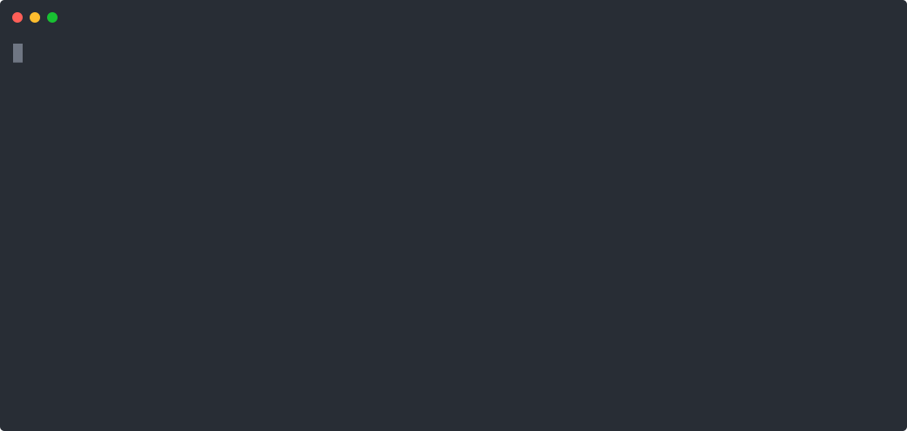
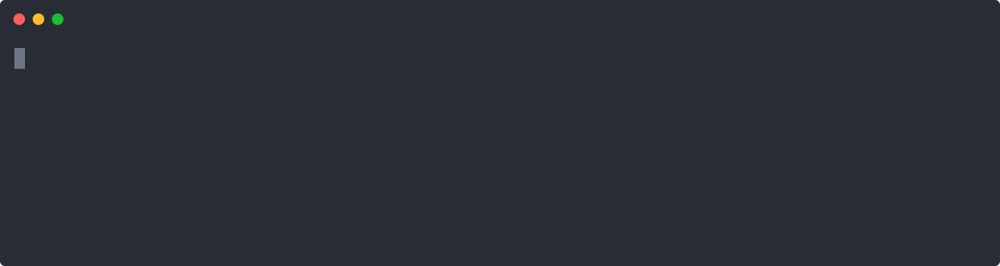
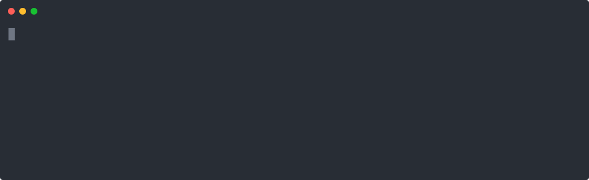
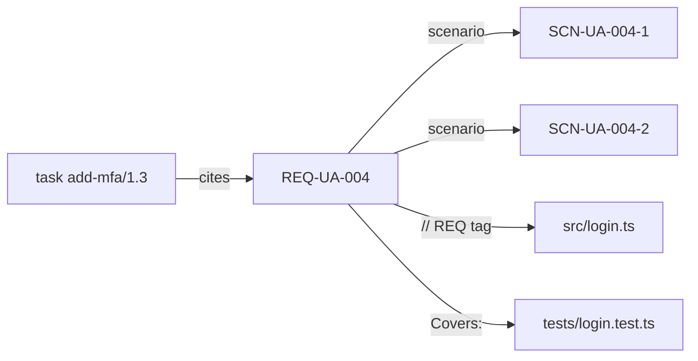

# spec-ctx

Stable IDs for OpenSpec. Your coding agent loads only the spec one task needs, and knows what to do next.

For teams that run Claude Code, Codex, or Cursor on an OpenSpec project.

## What OpenSpec is

[OpenSpec](https://github.com/Fission-AI/OpenSpec) is a folder named `openspec/` in your repo. It holds specs, the rules your software must follow, and changes. A change holds a proposal, a design, and a task list. A coding agent reads them and works down the list.

## The problem

Three things go wrong.

- The agent reads the whole `openspec/` tree for every task. Most of it is not about the task. Tokens go to text the agent will not use.
- OpenSpec links a change to a spec by header text. A reword breaks the link, and the agent loses the thread between requirement, code, and test.
- A new session starts cold. The agent does not know which task is next, what it already did, or which questions are open.

## What spec-ctx adds

| Without | With spec-ctx |
| --- | --- |
| The agent reads the whole `openspec/` tree. | The agent gets the bundle of one task: the requirements it cites, their scenarios, decisions, and neighbors. |
| Links go by header text. | Every requirement, scenario, decision, and task has an ID. Code and tests carry tags that name it. |
| Each session starts cold. | `status`, `task next`, and the generated handoff say where the work stands. |
| The agent ticks `[x]` by hand. | `[x]` appears only after the Verify command of the task exits 0. The run leaves an evidence file. |

A later edit can break a task that passed. `check --strict` names each task whose files changed after its Verify passed.

No LLM call. No daemon. The same files give the same output.

## See it work

Six commands on a small project. Each clip is one command.

### 1. Give every requirement an ID

OpenSpec names a requirement by its header text. A reword breaks every link to it. `adopt` gives each requirement and scenario an ID that stays. Run it once on a project that has specs. A new project gets IDs from `init --all`.


You see: the dry run prints each header and the ID it gets. Then `adopt` writes them.

### 2. Where are we

`status` shows the open change, the task counts, and the next command to run.


You see: one change, two tasks done, one open, and the hint.

### 3. What is next

`task next` picks the first open task. It prints the requirement IDs the task cites and the Verify command, the shell command that proves the task is done.


You see: task `add-mfa/1.3`, its requirement, and `grep -q totp src/login.ts`.

### 4. Only the spec this task needs

`task start` prints the requirement, its scenarios, the task line, and the test that covers it. Nothing else. The last line is the size of that bundle next to the size of all spec text.



You see: 711 characters, 3.6 percent of the tree. The agent reads this instead of the tree.

### 5. Done means Verify passed

`task done` runs the Verify command. On exit 1 the box stays open. On exit 0 the box flips to `[x]` and an evidence file records the files that were checked. The agent cannot tick the box by hand.



You see: a red refusal, the edit, then a green done line.

### 6. Hand off to the next session

`handoff write` puts the state in one file: the change, the done tasks, the current task, and the open questions. The next session starts from it.



You see: the head of `.ctx/handoff.md`.

The transcript of all six clips is in `docs/demo/loop.txt`. The clips run on a copy of `tests/fixtures/no-id-repo` plus the six capabilities in `docs/demo/specs/`. `bash docs/demo/record.sh` records them again.

## Quickstart

```bash
npx -y spec-ctx init --all              # config, schema, and three agent skills
npx -y spec-ctx task next               # the next task and the command that proves it
npx -y spec-ctx task start <task>       # only the spec that this task needs
npx -y spec-ctx task done <task>        # runs that command. A pass ticks the box.
```

A project with specs but no IDs needs `specctx adopt` first. See [Two paths](#two-paths).

## How it finds the context



The ID is the stable key. A reword of a header does not change it. The index is the graph of IDs: tasks, requirements, scenarios, decisions, code tags, and test tags. `bundle` walks the edges to the configured depth inside a character budget. A decision record joins the graph through its `Refs:` line. The demo fixture has none, so the graph above shows no decision.

`specctx related` prints each neighbor of an ID and the reason for the link. This is the output for the demo project after its last step:

```text
$ specctx related REQ-UA-004
scn  SCN-UA-004-1  active  openspec/changes/add-mfa/specs/user-auth/spec.md:8  scenario of REQ-UA-004
scn  SCN-UA-004-2  active  openspec/changes/add-mfa/specs/user-auth/spec.md:12  scenario of REQ-UA-004
task  add-mfa/1.3  done  openspec/changes/add-mfa/tasks.md:7  task cites REQ-UA-004
code  src/login.ts:1  active  src/login.ts:1  implements REQ-UA-004
test  tests/login.test.ts:1  active  tests/login.test.ts:1  covers REQ-UA-004
```

## The life cycle for agents

`init --all` installs three skills. Each one fires at a fixed point of the session.

- `specctx-bootstrap` fires at the start of a session. It reads the status and the handoff and starts the task.
- `specctx-next` fires after a task closes. It picks the next task and loads its bundle.
- `specctx-done` fires when the work is complete. It runs Verify, closes the task, and writes the handoff.

The loop that the skills teach:

```bash
specctx init --all             # config, schema, and the three skills
specctx status                 # active changes, current task, open questions
specctx task next              # the next open task, its REQ IDs, and its Verify command
specctx task start <task>      # the bundle of that task and its size
specctx task done <task>       # run Verify, write evidence, set the checkbox
specctx check --strict         # IDs, links, coverage, and evidence
specctx handoff write          # .ctx/handoff.md for the next session
```

The rule: the agent never opens `openspec/specs/` by hand. It uses `task start` or `bundle`. The skills are in [`skills/`](skills/). Install them alone with `npx skills add sonqh/spec-ctx` or `specctx init --skills`.

## Install

spec-ctx needs Node 22. Run it in a project after `openspec init`.

```bash
npx -y spec-ctx init --all                           # from npm
npm install -g spec-ctx                              # puts specctx on your path
npx -y github:sonqh/spec-ctx#<sha> init --all        # from git, for an unreleased commit
```

The git form builds the package on install with Node only. Pin a commit SHA. A branch name such as `main` also works, but it moves.

The command writes `spec-ctx.toml`, installs the `spec-driven-ids` schema into `openspec/schemas/`, adds its rules to `openspec/config.yaml`, and installs three skills into `.claude/skills/` and `.agents/skills/`.

The examples below use `specctx`. With `npx`, write `npx -y spec-ctx` in its place. Each GitHub release also carries a single binary for Linux and macOS.

## Two paths

### Fresh project

```bash
npx -y @fission-ai/openspec@latest init
npx spec-ctx init --all
specctx gate --strict
```

### Existing OpenSpec project

```bash
npx spec-ctx init --all
specctx adopt --dry-run                 # the ID that each header gets. Writes nothing.
specctx adopt                           # writes the IDs into main specs and active deltas
specctx task backfill --manual "adopted"
specctx baseline write
specctx gate --strict
```

- `adopt` gives an ID to every requirement and scenario header without one, in `openspec/specs/` and in the deltas of active changes. A delta header gets the main ID by its text or through its RENAMED line. A delta header that matches neither keeps its text and goes into `adopt-report.md`.
- `adopt` derives a capability code from each folder name, for example `UA` for `user-auth`. It writes the codes into `spec-ctx.toml`. Rename a code there before the IDs spread.
- `adopt` runs `check` before and after the write. A finding that the write added undoes every file. A second run prints `nothing to adopt`.
- `task backfill` writes manual evidence for every ticked task that has none.
- `baseline write` records the debt of the day in `.ctx/baseline.json`: untested requirements and scenarios, tasks without evidence, and legacy tasks without a citation or a Verify code span. `check` hides that debt and prints `baselined: <n>`. New debt still shows.
- Legacy tasks stay in the baseline until an agent adds `[REQ-...]` citations and a `Verify:` code span. `specctx baseline prune` then drops them. No command adds a single entry.

Both paths have an end to end test: `tests/paths/fresh.sh` and `tests/paths/existing.sh`.

## Commands

| Command | Use |
| --- | --- |
| `build` | Write `.ctx/index.json`. Every other command rebuilds a stale index first. |
| `status` | Active changes with task counts, the current task, and open questions. |
| `query <term...>` | Entries that hold every term. Flags: `--kind`, `--change`, `--limit`, `--all`. |
| `related <ID>` | Linked entries with the reason for each link. Flags: `--depth`, `--all`. |
| `bundle <ID...>` | Spec text of the IDs, their scenarios, decisions, and neighbors. Flags: `--budget`, `--depth`, `--all`. |
| `check` | ID and link integrity. `--strict` adds test coverage and evidence. |
| `id new`, `id retire` | Allocate and retire IDs. |
| `task next`, `start`, `verify`, `done`, `reopen` | The task state machine. |
| `handoff write`, `ask`, `resolve` | The session handoff and its open questions. |
| `init` | Config file, schema bundle, and skills. Flags: `--schema`, `--skills`, `--all`, `--force`. |
| `adopt` | IDs for a project without them. `--dry-run` writes nothing. |
| `baseline write`, `prune` | The debt ratchet in `.ctx/baseline.json`. |
| `task backfill` | Manual evidence for ticked tasks without it. |
| `gate` | `check`, both markdown linters, `openspec validate`, and the 500 character length check on active deltas. |
| `lint tells`, `lint ste` | The two markdown linters. Flags: `--baseline`, `--disable`, `--json`, `--selftest`. |
| `help <command>` | The page of one command. `specctx <command> --help` prints the same page. |

Every command takes `--root <path>` and `--json`. A task ID takes the change key, such as `008/1.1` or `add-mfa/1.1`, or the full folder name. Outside an OpenSpec project every command but `init` exits 2. Exit codes: 0 for success, 1 for findings or a failed Verify command, 2 for a usage error, 3 for an internal error.

## Config reference

`spec-ctx.toml` sits at the project root. Every key is optional.

```toml
[scan]
specs = ["openspec/specs/**/*.md"]      # main specs
changes = ["openspec/changes/**/*.md"]  # active and archived changes
decisions = ["decisions/*.md"]          # decision records
code = ["src/**"]                       # files with code tags
tests = ["tests/**"]                    # files with Covers tags and scenario IDs
ignore = []                             # globs that the scan skips

[ids]
caps = []                               # capability codes. Empty means any code is valid.
task_pattern = '\d+\.\d+'               # the task number in a tasks.md checkbox

[ids.paths]
UA = "user-auth"                        # capability path of each code. adopt writes the derived ones.

[bundle]
budget = 8000                           # characters
depth = 1

[verify]
timeout_s = 600
```

One environment variable changes the engine:

| Variable | Effect |
| --- | --- |
| `SPECCTX_OPENSPEC` | The command that `gate` runs for `openspec validate`. The default is `npx -y @fission-ai/openspec@latest`. Tests and offline machines set it. |

## Markdown linters

`specctx lint tells` and `specctx lint ste` replace `scripts/tells-lint.py` and `scripts/ste-lint.py` from the ste-humanize skill. They take the same flags and give the same output and exit codes. They need Node only.

```bash
# before
python3 scripts/tells-lint.py --baseline 0 README.md
python3 scripts/ste-lint.py --baseline 0 --disable synonym-rotation README.md
# after
npx spec-ctx lint tells --baseline 0 README.md
npx spec-ctx lint ste --baseline 0 --disable synonym-rotation README.md
```

## GitHub Action

```yaml
- uses: sonqh/spec-ctx@v0
  with:
    version: latest   # npm version, or a git spec such as github:sonqh/spec-ctx#main
    strict: true
```

The action runs `specctx gate`: `check --strict`, both markdown linters, `openspec validate --all --strict`, and the length check.

## Status

- Published: `spec-ctx@0.1.0` on npm, with tags `v0.1.0` and `v0` and binaries on the GitHub release.
- Archived: 001 to 012. No change is open.
- A version bump on `main` publishes the next release. See `docs/CONTRIBUTING.md`.
- Upstream: the ID scheme is proposed as a comment on [OpenSpec#1967](https://github.com/Fission-AI/OpenSpec/issues/1967#issuecomment-6414314730). No pull request until a maintainer asks.

## Measured

`specctx stats --write` measures this repository after each change. The newest file is `docs/metrics/2026-10-26.md`. Its total row:

| change | context_ratio | evidence_ratio | stale_catches | cycle_time_median_s | debt |
| --- | --- | --- | --- | --- | --- |
| total | 0.0469 (n=41) | 0.85 (88/104) | 36 (of 62 reopens) | 60 (n=41) | 0 (0 baselined + 0 new) |

- `context_ratio`: the size of one task bundle divided by the size of all spec text. Lower is better.
- `evidence_ratio`: done tasks with a passed Verify command, divided by all done tasks. The rest have a manual note. Higher is better.
- `stale_catches`: reopened tasks that `check --strict` flagged as stale, out of all reopened tasks. A higher share means the check found the drift before a person did.
- `cycle_time_median_s`: the median number of seconds from `task start` to `task done`. Lower is faster.
- `debt`: findings that the baseline hides plus new findings. Zero is the goal.

The value in brackets is the count of inputs. A value without inputs reads n/a.

## Contribute

`docs/CONTRIBUTING.md` holds the build steps, the layout, the ID scheme, and the gate steps.

## License

MIT.
