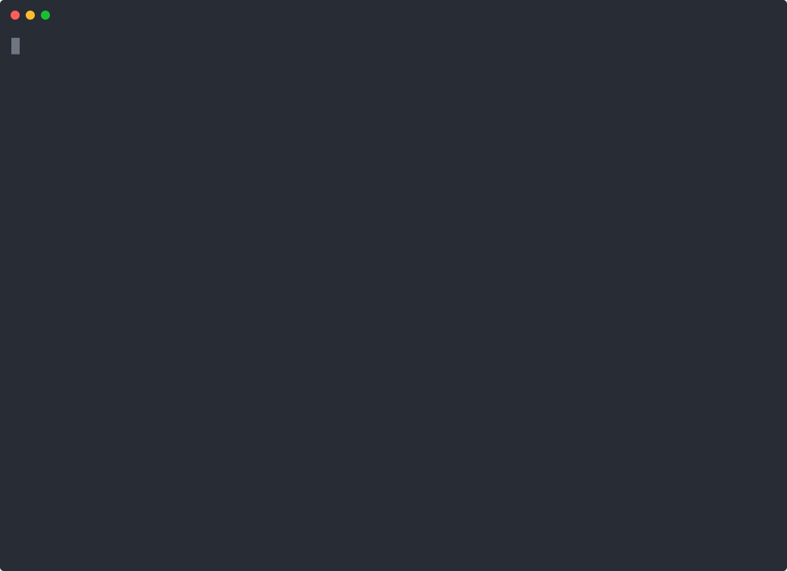

# spec-ctx

Your coding agent reads only the spec it needs, and cannot tick a task until its Verify command passes.

For teams that run Claude Code, Codex, or Cursor on an OpenSpec project.

## The problem

[OpenSpec](https://github.com/Fission-AI/OpenSpec) keeps the specs and a task list of a change in your repo. A coding agent works down the list. Three things go wrong.

- The agent ticks a task when it thinks it finished. No test ran. The `[x]` is a claim.
- The agent reads every spec file for a small task. The part that matters is lost in the rest.
- A task passed last week. Then a later edit broke it, and the box still says done.

## What spec-ctx does

| Without | With spec-ctx |
| --- | --- |
| The agent ticks `[x]` by hand. | `[x]` appears only after the Verify command of the task exits 0. The run leaves an evidence file. |
| The agent reads the whole `openspec/` tree. | The agent gets a few kilobytes: the requirements and scenarios that the task names. |
| An old `[x]` stays after a later edit. | `check --strict` names each task whose files changed after its Verify passed. |

No LLM call. No daemon. The same files give the same output.

## Demo



The plain text transcript is in `docs/demo/loop.txt`. The demo runs on a copy of `tests/fixtures/no-id-repo` after `specctx adopt`. `bash docs/demo/record.sh` records it again.

## Quickstart

```bash
npx -y spec-ctx init --all              # config, schema, and three agent skills
npx -y spec-ctx task next               # the next task and the command that proves it
npx -y spec-ctx task done <task>        # runs that command. A pass ticks the box.
```

A project with specs but no IDs needs `specctx adopt` first. See [Two paths](#two-paths).

## Install

spec-ctx needs Node 22. Run it in a project after `openspec init`.

```bash
npx -y spec-ctx init --all                           # from npm
npm install -g spec-ctx                              # puts specctx on your path
npx -y github:sonqh/spec-ctx#<sha> init --all        # from git, for an unreleased commit
```

The git form builds the package on install with Node only. Pin a commit SHA. A branch name such as `main` also works, but it moves.

The command writes `spec-ctx.toml`, installs the `spec-driven-ids` schema into `openspec/schemas/`, adds its rules to `openspec/config.yaml`, and installs three skills into `.claude/skills/` and `.agents/skills/`.

The examples below use `specctx`. With `npx`, write `npx -y spec-ctx` in its place. Each GitHub release also carries a single binary for Linux and macOS.

## Two paths

### Fresh project

```bash
npx -y @fission-ai/openspec@latest init
npx spec-ctx init --all
specctx gate --strict
```

### Existing OpenSpec project

```bash
npx spec-ctx init --all
specctx adopt --dry-run                 # the ID that each header gets. Writes nothing.
specctx adopt                           # writes the IDs into main specs and active deltas
specctx task backfill --manual "adopted"
specctx baseline write
specctx gate --strict
```

- `adopt` gives an ID to every requirement and scenario header without one, in `openspec/specs/` and in the deltas of active changes. A delta header gets the main ID by its text or through its RENAMED line. A delta header that matches neither keeps its text and goes into `adopt-report.md`.
- `adopt` derives a capability code from each folder name, for example `UA` for `user-auth`. It writes the codes into `spec-ctx.toml`. Rename a code there before the IDs spread.
- `adopt` runs `check` before and after the write. A finding that the write added undoes every file. A second run prints `nothing to adopt`.
- `task backfill` writes manual evidence for every ticked task that has none.
- `baseline write` records the debt of the day in `.ctx/baseline.json`: untested requirements and scenarios, tasks without evidence, and legacy tasks without a citation or a Verify code span. `check` hides that debt and prints `baselined: <n>`. New debt still shows.
- Legacy tasks stay in the baseline until an agent adds `[REQ-...]` citations and a `Verify:` code span. `specctx baseline prune` then drops them. No command adds a single entry.

Both paths have an end to end test: `tests/paths/fresh.sh` and `tests/paths/existing.sh`.

## The loop

```bash
specctx status                 # active changes, current task, open questions
specctx task next              # the next open task, its REQ IDs, and its Verify command
specctx task start 001/1.1     # the spec bundle for that task
specctx task done 001/1.1      # run Verify, write evidence, set the checkbox
specctx check --strict         # IDs, links, coverage, and evidence
specctx handoff write          # .ctx/handoff.md for the next session
```

The skills `specctx-bootstrap`, `specctx-next`, and `specctx-done` teach an agent this loop. Install them alone with `npx skills add sonqh/spec-ctx` or `specctx init --skills`.

## Commands

| Command | Use |
| --- | --- |
| `build` | Write `.ctx/index.json`. Every other command rebuilds a stale index first. |
| `status` | Active changes with task counts, the current task, and open questions. |
| `query <term...>` | Entries that hold every term. Flags: `--kind`, `--change`, `--limit`, `--all`. |
| `related <ID>` | Linked entries with the reason for each link. Flags: `--depth`, `--all`. |
| `bundle <ID...>` | Spec text of the IDs, their scenarios, decisions, and neighbors. Flags: `--budget`, `--depth`, `--all`. |
| `check` | ID and link integrity. `--strict` adds test coverage and evidence. |
| `id new`, `id retire` | Allocate and retire IDs. |
| `task next`, `start`, `verify`, `done`, `reopen` | The task state machine. |
| `handoff write`, `ask`, `resolve` | The session handoff and its open questions. |
| `init` | Config file, schema bundle, and skills. Flags: `--schema`, `--skills`, `--all`, `--force`. |
| `adopt` | IDs for a project without them. `--dry-run` writes nothing. |
| `baseline write`, `prune` | The debt ratchet in `.ctx/baseline.json`. |
| `task backfill` | Manual evidence for ticked tasks without it. |
| `gate` | `check`, both markdown linters, `openspec validate`, and the 500 character length check on active deltas. |
| `lint tells`, `lint ste` | The two markdown linters. Flags: `--baseline`, `--disable`, `--json`, `--selftest`. |
| `help <command>` | The page of one command. `specctx <command> --help` prints the same page. |

Every command takes `--root <path>` and `--json`. A task ID takes the change key, such as `008/1.1` or `add-mfa/1.1`, or the full folder name. Outside an OpenSpec project every command but `init` exits 2. Exit codes: 0 for success, 1 for findings or a failed Verify command, 2 for a usage error, 3 for an internal error.

## Config reference

`spec-ctx.toml` sits at the project root. Every key is optional.

```toml
[scan]
specs = ["openspec/specs/**/*.md"]      # main specs
changes = ["openspec/changes/**/*.md"]  # active and archived changes
decisions = ["decisions/*.md"]          # decision records
code = ["src/**"]                       # files with code tags
tests = ["tests/**"]                    # files with Covers tags and scenario IDs
ignore = []                             # globs that the scan skips

[ids]
caps = []                               # capability codes. Empty means any code is valid.
task_pattern = '\d+\.\d+'               # the task number in a tasks.md checkbox

[ids.paths]
UA = "user-auth"                        # capability path of each code. adopt writes the derived ones.

[bundle]
budget = 8000                           # characters
depth = 1

[verify]
timeout_s = 600
```

One environment variable changes the engine:

| Variable | Effect |
| --- | --- |
| `SPECCTX_OPENSPEC` | The command that `gate` runs for `openspec validate`. The default is `npx -y @fission-ai/openspec@latest`. Tests and offline machines set it. |

## Markdown linters

`specctx lint tells` and `specctx lint ste` replace `scripts/tells-lint.py` and `scripts/ste-lint.py` from the ste-humanize skill. They take the same flags and give the same output and exit codes. They need Node only.

```bash
# before
python3 scripts/tells-lint.py --baseline 0 README.md
python3 scripts/ste-lint.py --baseline 0 --disable synonym-rotation README.md
# after
npx spec-ctx lint tells --baseline 0 README.md
npx spec-ctx lint ste --baseline 0 --disable synonym-rotation README.md
```

## GitHub Action

```yaml
- uses: sonqh/spec-ctx@v0
  with:
    version: latest   # npm version, or a git spec such as github:sonqh/spec-ctx#main
    strict: true
```

The action runs `specctx gate`: `check --strict`, both markdown linters, `openspec validate --all --strict`, and the length check.

## Status

- Published: `spec-ctx@0.1.0` on npm, with tags `v0.1.0` and `v0` and binaries on the GitHub release.
- Archived: 001 to 010. No change is open.
- A version bump on `main` publishes the next release. See `docs/CONTRIBUTING.md`.

## Measured

`specctx stats --write` measures this repository after each change. The newest file is `docs/metrics/2026-10-26.md`. Its total row:

| change | context_ratio | evidence_ratio | stale_catches | cycle_time_median_s | debt |
| --- | --- | --- | --- | --- | --- |
| total | 0.0502 (n=27) | 0.82 (72/88) | 36 (of 60 reopens) | 26 (n=27) | 0 (0 baselined + 0 new) |

- `context_ratio`: the size of one task bundle divided by the size of all spec text. Lower is better.
- `evidence_ratio`: done tasks with a passed Verify command, divided by all done tasks. The rest have a manual note. Higher is better.
- `stale_catches`: reopened tasks that `check --strict` flagged as stale, out of all reopened tasks. A higher share means the check found the drift before a person did.
- `cycle_time_median_s`: the median number of seconds from `task start` to `task done`. Lower is faster.
- `debt`: findings that the baseline hides plus new findings. Zero is the goal.

The value in brackets is the count of inputs. A value without inputs reads n/a.

## Contribute

`docs/CONTRIBUTING.md` holds the build steps, the layout, the ID scheme, and the gate steps.

## License

MIT.
