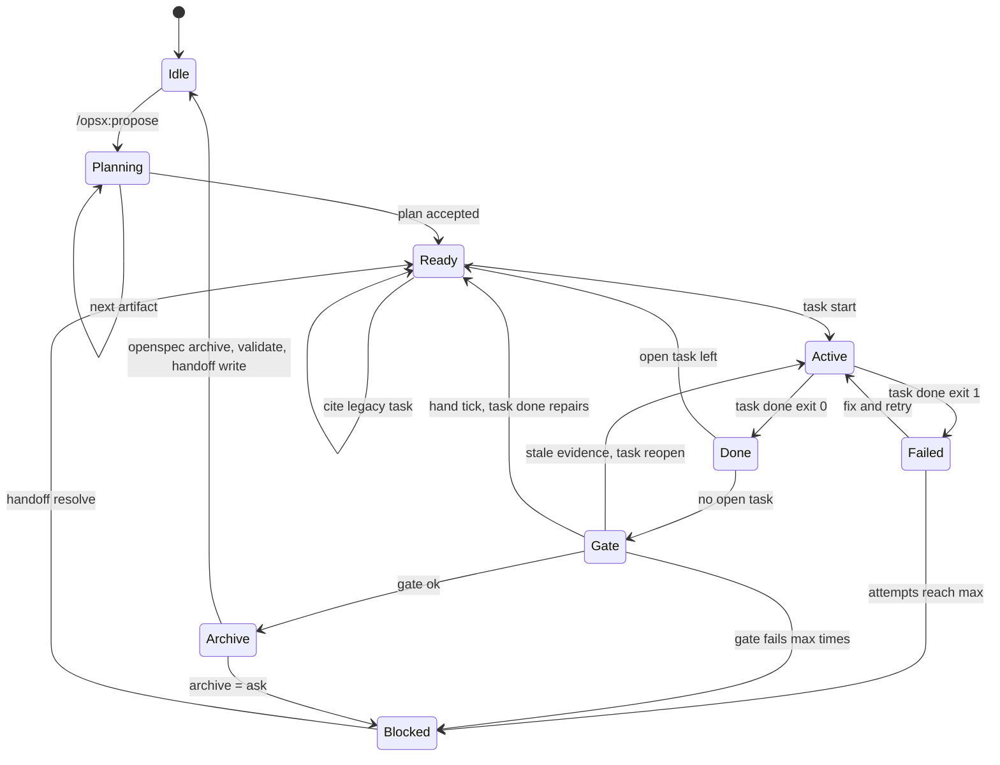

# spec-ctx architecture review, 2026-10-28

## Problem

The context engine works. The weak part is the seam between spec-ctx and OpenSpec. Two tools parse `tasks.md`. Two skills give opposite orders about the checkbox. Two forks must follow upstream: the CLI and the schema. The task loop has a bypass that an autonomous agent will find.

## Evidence

- Source: 5,439 lines in `src/`. The linters (`src/lint/*.ts`) are 1,242 of them, 23 percent. 60 test files.
- `.ctx/handoff.md` is 12,930 bytes, mostly resolved questions that never leave.
- `schemas/spec-driven-ids/schema.yaml`: 301 lines. About 23 lines are spec-ctx text (160 to 169, 207 to 211, 282 to 289). The rest is a copy of upstream `spec-driven` 1.14.3. Line 300 still says "mark complete as you go".
- Fork branch `spec-ctx-adopt`: 10 commits. 15 non-spec files, 1,360 insertions. The package rename alone touches 13 files (d462272, 7f9faa0). The adopt commit 2c87852 touched 1,924 files.
- Upstream apply skill, `src/core/templates/workflows/apply-change.ts:130`: "Mark the task complete ... `- [ ]` → `- [x]`". Lines 92 to 103 say `operationGuidance` is advisory and loses to the built-in instruction.
- `openspec instructions apply --json` returns `tasks[]` with `id: "1"`, `sourcePath`, `line`, `done`, plus `state` and `operationGuidance`. `openspec status --json` returns `artifacts[]`, `isPlanningComplete`, `nextSteps`.

## Findings, ranked

1. Correctness, contract violation. `task done <t> --manual "<note>"` closes a task that has a Verify command without running it (`src/cli/workflow.ts:112-122`). `check --strict` only warns `manual-evidence`, and `baseline write` can absorb it. ADR-004 says the box flips only after Verify passed. An autonomous agent that fails Verify three times will take this exit.

2. Correctness, the ratchet is not a ratchet. `baseline write` replaces `.ctx/baseline.json` with every current finding (`src/baseline/baseline.ts:43`). No step compares it to the base branch. A PR that runs `baseline write` hides any new debt and the gate in CI goes green. 

3. Contract conflict between the two skill sets. CLAUDE.md tells the agent to use `/opsx:apply`. That skill ticks boxes by hand at `sourcePath:line`. spec-ctx says never tick by hand, but only through advisory `operationGuidance`, which the upstream skill is told to drop on conflict. The schema's own `apply.instruction` (line 299 to 301) agrees with upstream. Result: hand ticks, then `done-without-evidence` at gate, and `task done` refuses a ticked task (`workflow.ts:124`). There is no repair path except `--manual`, which is finding 1.

4. Contract drift, two parsers of `tasks.md`. OpenSpec counts `- [ x]` and unnumbered checkboxes. spec-ctx matches `\[([ xX]?)\]` plus `task_pattern` (`src/index/scan.ts:51`, `src/tasks/tasks.ts:100`). Such lines are invisible to spec-ctx. Task IDs differ too: `"1"` there, `<key>/1.1` here. The dogfood showed 28 changes in `status` and 30 in `openspec list`. REQ citations allow exactly three digits (`scan.ts:18`). The fork allows three or more.

5. Data loss and duplicated state. `.ctx/handoff.md` is called generated, but it is the only store of open questions and resolved answers. Reopen reasons live both there and in `.reopened-*.json`. `init` does not ignore `.ctx/gate-log.jsonl` (`src/init/init.ts:153`), so adopters commit an append-only log. The fork did in 2a2b6db and removed it in 8899171. `.ctx/current.json` is per-session state and is committed too. Two agents on two branches will conflict on it.

6. Regression for adopters. When `openspec/config.yaml` already has `rules`, `init --schema` keeps it, so new changes never get the ID and Verify rules from the config. Combined with a change pinned to `spec-driven` in `.openspec.yaml`, the agent sees no spec-ctx instruction at all.

7. Determinism leak. The default `[gate] openspec` is `npx -y @fission-ai/openspec@latest`. The same files can pass today and fail next week. This breaks the spirit of ADR-003.

8. Verify quality is unchecked. `Verify: \`true\`` passes. Evidence `files` is empty when no file carries the cited tag, and then `stale-evidence` can never fire.

9. Metrics measure wording. `stale_catches` counts reopen reasons that contain the substring `stale` (`src/stats/stats.ts:100`). Cycle times of 0 and 1 s show start and done run back to back. The `specctx-done` skill runs `stats` after every task, which costs tokens and proves nothing.

10. Minor contract gap. REQ-CLI-007 says `status` ends with a `next:` line. With no active change it does not. A loop needs a defined terminal state. REQ-CLI-002 still names `scripts/ste-lint.py`. The README existing path still lists `task backfill`.

## Disagreements with decisions taken

- ADR-001 still calls the Python tests the contract for the port. The Python engine is gone (REQ-DIST-007). The goldens are now just goldens. Rewrite the consequence or retire it.
- ADR-005 is right for this repo. Shipping it as a gate to adopters was wrong. The dogfood found 2,096 findings in prose nobody agreed to write in STE.
- ADR-002 gives design decisions positional IDs (`<key>/D<n>`). An edit that inserts a bullet renumbers every later one in silence. Write the ID into the bullet like every other kind.
- The baseline as designed. Keep one file, but make `gate` fail when `baseline.json` gains entries compared with the merge base, unless the commit subject starts with `baseline:`. The same pattern as REQ-GOV-007.

## Q1. task backfill

Remove it. Retire REQ-TASK-006. The baseline already covers legacy ticked tasks. One combined file is new state with a new shape that `check` and `stats` must learn. Replace the need with one repair rule in `task done`: on a ticked task with no evidence, run Verify and write evidence on exit 0. That also fixes finding 3. Remove the hidden backfill branch inside `--manual` (`workflow.ts:114-118`). Trade-off: no one-command paper trail for legacy work. The baseline line says the same thing.

## Q2. The fork

Stop maintaining it. Freeze `spec-ctx-adopt` as a tagged dogfood fixture. Close draft PR #1. The value of the fork is one case: a retitle under a stable ID without a RENAMED block. Upstream already supports RENAMED, and FROM and TO can both carry the ID. Move the work into spec-ctx. Add a `check` rule `retitle-needs-renamed`: a delta header whose ID exists in main with other text and no RENAMED line. Its hint prints the exact block to paste. This is deterministic and needs no upstream change. Keep the upstream ask at the issue level (#1967). If upstream ever takes ID matching, ask for a configurable leading-token regex, not the hard-coded `(REQ|SCN)-[A-Z]{2,6}` that the fork puts in `requirement-blocks.ts`. Trade-off: a retitle needs a RENAMED block. The fork costs more. Every upstream release can touch `specs-apply.ts` and `validator.ts`, the rename touches 13 more files, and a stranger must install a tarball.

## Q3. Closed loop

Put the transition function in spec-ctx and keep the state where it already lives. Do not use `schema.yaml`. Upstream schemas model only planning artifacts by file existence. They have no verify, gate, or archive state, and extending them means a fork. Do not put it in the handoff, which is a view. Do not put it in the skill chain. State held in the context window is lost on compaction and is not deterministic. Do not add a state file. Two small stores are needed and both replace something: failed Verify runs and open questions.

The contract is one new read command, `specctx next --json`. It is a pure function of the files. It prints one object:

```json
{"state":"task_failed","change":"019-x","task":"019-x/1.2","action":"fix","command":"specctx task done 019-x/1.2","attempt":2,"max_attempts":3,"human":false,"reason":"Verify failed (exit 1)"}
```

`action` is a closed enum: `plan`, `cite`, `start`, `work`, `fix`, `repair`, `gate`, `archive`, `ask`, `stop`. The skill dispatches on it and stops on any value it does not know. OpenSpec keeps ownership of planning. When a change has no `tasks.md`, `next` returns `action: plan` with `command: openspec status --change <c> --json`, and the skill follows OpenSpec's `nextSteps` and `openspec instructions <artifact> --json`. spec-ctx never reimplements the artifact graph.

The LLM may decide artifact text, code, the Verify command at planning time, the fix after a failure, the citation for a legacy task, and the text of a question. The LLM may not tick a box, write evidence, write the baseline, use `--manual` on a task with a Verify span, or archive. Each of those is a command whose precondition the engine checks.

One user skill, `specctx-run`, replaces `specctx-bootstrap`, `specctx-next`, and `specctx-done`. The user knows two commands: `/opsx:propose` (theirs already) and `/specctx-run`. The skill loops: run `next`, act, run `handoff write`, repeat. A new session runs the same skill and resumes, because nothing lives in the context.

Degradation. A failed Verify writes `.ctx/evidence/<c>/<t>.fail-<n>.json` with the exit code and tail. `next` counts them since the last start. At `[loop] max_attempts` (default 3) the state becomes `blocked`. The engine writes the question itself with the tail, and the skill stops. A human gate is any open question that names the change, plus archive when `[loop] archive = "ask"` (the default). The human answers with `handoff resolve`, then runs `/specctx-run` again.

## Q4. What to cut

Cut the parts that make the same fix land twice: the fork, the schema copy, the backfill command, the three skills, and the linters inside the engine. Reasons are in "What to cut". Do not build a new state file or a schema extension for the loop.

## Q5. Rollout

A stranger installs Node 22, upstream OpenSpec, and spec-ctx. The fork is not on the path.

First 10 minutes on a fresh project:

1. `npx -y @fission-ai/openspec@<pinned> init --tools claude`.
2. `npx -y spec-ctx init --all`. It writes the config with the detected OpenSpec version pinned, the templates, the merged rules, and one skill.
3. `/opsx:propose add greeting`.
4. `/specctx-run`. It stops at the archive gate with a one-line question.

An existing project adds `adopt --dry-run`, `adopt`, and `baseline write` before step 3. On a legacy task `/specctx-run` enters `cite` and adds the REQ and Verify span.

What blocks a stranger today:

- The getting-started guide asks for a tarball install of the fork and a hand edit of `[gate] openspec`.
- The same guide says to skip `/opsx:propose` and copy templates by hand.
- `/opsx:apply` and the spec-ctx skills disagree about the checkbox.
- Existing `rules` keys hide the spec-ctx rules.
- Legacy tasks give an empty bundle until someone cites them.
- The 50 CAP codes on the fork are unreadable (friction item 4 is still open).
- The gate fails on the adopter's own `openspec validate --all --strict` failures. Offer `[gate] validate = "changes"`, which validates only the active changes.
- Change 018 is on `main` and not on npm.

## Target architecture for Q3



Each transition, in order:

- Idle to Planning. Tool: `/opsx:propose`. The LLM decides scope. Evidence: the change folder.
- Planning to Planning. Tool: `openspec instructions <artifact> --change <c> --json`. Deterministic part: the artifact graph in `openspec status --json`. The LLM writes the artifact and allocates IDs with `specctx id new`. Evidence: the artifact files. Stop: `isPlanningComplete`.
- Planning to Ready. Tool: `specctx check --change <c>` and `openspec validate <c> --strict`. Deterministic part: no `missing-id`, `task-without-req`, `task-without-verify`, or `unknown-task-req`. Evidence: exit codes. Stop: a finding sends the agent back to Planning.
- Ready to Ready. Tool: an edit of one task line, then `check`. The LLM picks the REQ and the Verify span with `specctx query --change <c> --kind req`. Evidence: the task line. Stop: `check` exit 0 on that line.
- Ready to Active. Tool: `specctx task start <t>`, `t` from `task next`. Deterministic part: group order. Evidence: `current.json` with the Verify command.
- Active to Done or Failed. Tool: `specctx task done <t>`. Deterministic part: the exit code of `sh -c`. `done` refuses when the Verify command differs from the one in `current.json`. The LLM decides the code. Evidence: `<t>.json` or `<t>.fail-<n>.json`. Stop: `max_attempts`.
- Done to Gate. Tool: `specctx gate --strict`. Deterministic part: `check`, validate with a pinned OpenSpec, and the baseline compared to the merge base. The LLM fixes findings. Evidence: the gate output, which is not committed. Stop: `[loop] max_gate_runs`.
- Gate to Archive to Idle. Tool: `openspec archive <c> -y`, then `openspec validate --all --strict`, `specctx check --strict`, `specctx handoff write`. Deterministic part: all four exit 0. Evidence: the archive folder and the handoff. Stop: the human gate when `archive = "ask"`.
- Any state to Blocked. Tool: `specctx handoff ask`. The LLM writes the question. Evidence: `.ctx/questions.json`. Stop: always. Only a human leaves this state.

Also: move open questions to `.ctx/questions.json` so `handoff.md` is a pure view, and ignore `current.json` and `gate-log.jsonl`.

## What to cut

- `task backfill` and REQ-TASK-006.
- The fork and its package `@sonqh/specctx-openspec`. Keep a tag.
- Three skills, merged into `specctx-run`. Delete the repo-local `bootstrap-context` skill. The owner's repo should run the skill it ships.
- The schema copy. Keep `schemas/spec-driven-ids/` only as templates plus the config fragment. Merge `rules` per item into an existing key, so adopters get them (finding 6). Use upstream `spec-driven` as the schema. Then no 278 lines of upstream text to resync.
- The linters out of the engine. Publish them with the ste-humanize skill as their own package. Turn the gate lint step off by default for adopters (`[gate] markdown = []`). This repo opts in. It removes 23 percent of the source, the Python string shims in `src/util/pystr.ts`, and the reason change 016 existed.
- `stats` from the done skill. Keep `stats` as a command. Replace the `stale` substring rule with a field that `task reopen` writes from a real `stale-evidence` finding.
- REQ-GOV-006 and REQ-GOV-008. They spec the README layout and demo clip sizes. Every README edit becomes a change. Keep them as doc tests.
- `DELEGATION.md`, which describes the finished build of 001 to 003.

## Risks

- Fix findings 1 and 2 before `specctx-run` ships. A loop turns every bypass into a habit and green gates then mean nothing.
- An agent can weaken a Verify command at planning time. The `current.json` freeze only guards the work phase. Add an advisory rule that a Verify span names a file with `Covers:` for a cited REQ.
- Upstream can change the JSON of `openspec status` and `instructions`. spec-ctx would then depend on fields it does not own. Read only `isPlanningComplete` and `nextSteps`. Pin the version. Add one contract test that runs the pinned CLI on a fixture.
- An unattended loop runs Verify spans from `tasks.md` with `sh -c`. A hostile change file runs code. Run the loop only on trusted branches.
- Without the fork, a retitle needs a RENAMED block. The `retitle-needs-renamed` hint must be good enough to paste as is, or the pressure to fork returns.
